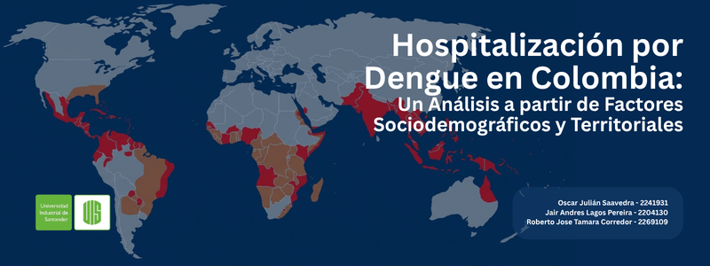

# Hospitalización por Dengue en Colombia: Un Análisis a partir de Factores Sociodemográficos y Territoriales

  

## Autores
Oscar Julián Saavedra (2241931), Jair Andres Lagos Pereira (2204130), Roberto Jose Tamara Corredor (2269109)

## Objetivo
Predecir la necesidad de hospitalización (`PAC_HOS`) en pacientes con dengue en Colombia a partir de factores sociodemográficos, territoriales y síntomas clínicos, priorizando la exhaustividad (Recall) para reducir falsos negativos.

## Dataset
- **Datasets Sociodemográficos y Territoriales:** [AQUI VA LA PARTE DE LOS SOCIODEMOGRAFICOS]
- **Dataset Clínico de Síntomas (`Dataset3_SIVIGILA_Sintomas.csv`):** Registros epidemiológicos de dengue (SIVIGILA, Medellín 2010) con `53.813` pacientes depurados (`DELTA_T >= 0`), pasando de `38` columnas originales a `28` variables predictoras + objetivo `PAC_HOS` (`79.03%` ambulatorios vs. `20.97%` hospitalizados), tras eliminar identificadores y fugas de datos como `clas_dengue` y `comuna`. Incluye `16` síntomas clínicos binarizados (`0/1`), edad en años (`EDAD_A`), días de evolución (`DELTA_T`), sexo, desplazamiento, régimen de salud (One-Hot) y `semana` sin fuga de datos, con partición estratificada `70/30` (`37.669` entrenamiento / `16.144` prueba, `random_state=666`).

- **Enlace de descarga del dataset:** [Descargar Datasets SIVIGILA](https://drive.google.com/drive/folders/14BLk4EUQeCIBEAWmkMLMtcvApb0oUdtg?usp=sharing)

## Modelos
Gaussian Naive Bayes, Regresión Logística, Árbol de Decisión, Random Forest, Support Vector Machine (Linear, RBF, Poly, Sigmoid), Red Neuronal Multicapa (MLP / Deep Neural Network), GridSearchCV, RandomizedSearchCV, Stratified K-Fold Cross-Validation, PCA, t-SNE, K-Means, Método del Codo, Clustering Jerárquico Aglomerativo (Ward), DBSCAN.

## Enlaces
- **Repositorio:** [GitHub - Proyecto Dengue IA I](https://github.com/juliansaav12/Proyecto-funcional-IA-)
- **Código (Notebooks):**
  - [Notebook: Proyecto-Dengue](notebook/Proyecto-Dengue.ipynb)
- **Video en YouTube:** [Ver Video Sustentación](PEGA_AQUI_EL_LINK_DE_YOUTUBE_CUANDO_LO_TENGAN)
- **Archivo de Video (.mp4):** [Descargar Archivo de Video](https://drive.google.com/drive/folders/1AFRlBjTgpxH60yd9pRKG5NFAw4fmDWF4?usp=sharing)
